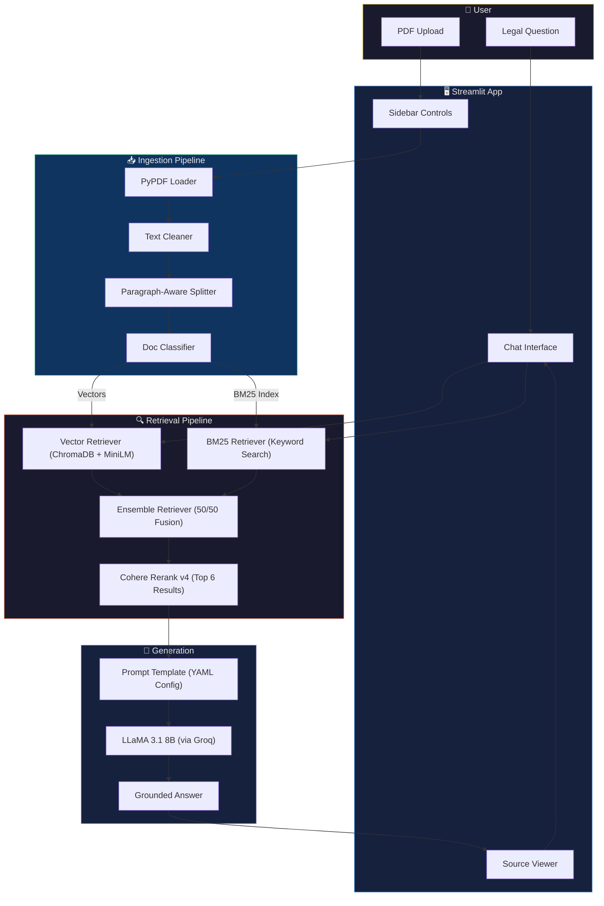
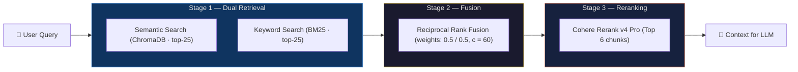
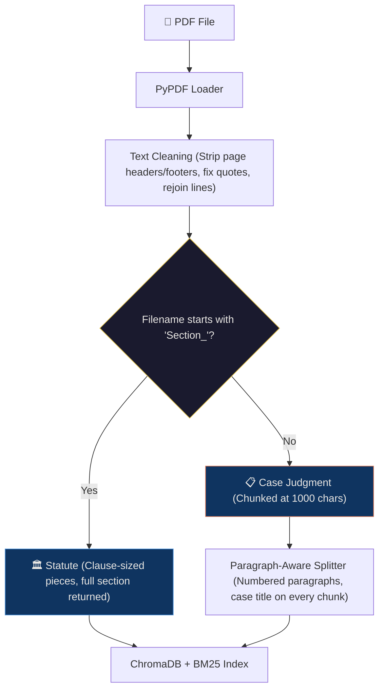

<p align="center">
  
  
  
  
  
</p>

# ⚖️ LegalEase

**A production-grade RAG system for Indian legal case law — powered by hybrid retrieval, neural reranking, and automated quality evaluation.**

LegalEase helps legal professionals, law students, and researchers query Indian court judgments and statutory provisions using natural language. It retrieves relevant legal passages, reranks them for precision, and generates grounded answers with full source citations.

---

## ✨ Features at a Glance

| Feature | Description |
|---|---|
| 🔍 **Hybrid Search** | Combines semantic (vector) + keyword (BM25) retrieval for best recall |
| 🏆 **Neural Reranking** | Cohere Rerank v4 re-scores results to surface the most relevant chunks |
| 📄 **Live Document Upload** | Upload PDFs via the sidebar — auto-ingested into the knowledge base |
| 🏛️ **Statute vs. Case Tagging** | Documents auto-classified as `Statute` or `Case` with visual badges |
| 🎛️ **Prompt Versioning** | 5 built-in prompt personas + custom prompt mode |
| 📊 **Two-Layer Evaluation** | Deterministic retrieval recall / precision / MRR, plus RAGAS faithfulness, relevancy, precision & recall |
| 🔄 **CI/CD Quality Gate** | GitHub Actions pipeline that fails if retrieval recall or faithfulness drops |
| 💬 **Chat Interface** | Streamlit-powered conversational UI with follow-up questions and source transparency |

---

## 🏗️ System Architecture



---

## 🔄 Retrieval Pipeline — Deep Dive

The retrieval strategy uses a **three-stage pipeline** to maximize both recall and precision:



| Stage | What it Does | Why it Matters |
|---|---|---|
| **Dual Retrieval** | Runs both vector similarity and BM25 keyword search in parallel | Captures both semantic meaning *and* exact legal terminology |
| **Ensemble Fusion** | Merges results using Reciprocal Rank Fusion (RRF) | Balances recall across both retrieval paradigms |
| **Neural Reranking** | Cohere's cross-encoder re-scores all candidates | Pushes the most contextually relevant chunks to the top |

BM25 uses a lowercased alphanumeric tokenizer, so `138`, `138,` and `Section`/`section` all match. The index is built in memory from ChromaDB at start-up, so it can never drift out of sync with the vector store. The candidate and rerank sizes can be changed with the `VECTOR_K`, `BM25_K` and `RERANK_TOP_N` environment variables.

---

## 📥 Document Ingestion

Documents are processed differently based on their type:



- **Statutes** (e.g., `Section_138_in_The_Negotiable_Instruments_Act_1881.PDF`) → short sections are one chunk. Long sections are indexed as clause-sized pieces (main clause, provisos, Explanation) so every clause is searchable, and the retriever hands the **full section** to the LLM to preserve statutory context. The embedding model only reads the first 256 tokens of a chunk, which is why a long section cannot be embedded whole.
- **Case Judgments** → pages are joined, then split on numbered paragraphs into chunks of up to 1000 characters. The case name is prefixed to every chunk, so both retrievers and the LLM always know which judgment a passage comes from.
- **Cleaning** → the Indian Kanoon footer and repeated page title are stripped, and mis-decoded quote/dash characters are repaired.
- **Sync** → `ingest_data.py` re-ingests files whose contents changed and removes chunks of files deleted from `data/`. If you change the cleaning, chunking or embedding model, bump `INDEX_VERSION` in `ingest_data.py` so the corpus is rebuilt into a fresh collection.

---

## 🎛️ Prompt Versioning System

LegalEase ships with **5 prompt versions**, each tailored for a different legal research task. Prompts are managed via `prompts.yaml` and selectable from the sidebar.

| Version | Persona | Best For |
|---|---|---|
| `v1` ⭐ | Friendly Explanatory Assistant | General legal Q&A — accessible language + Key Takeaway |
| `v2` | Contract Risk Analyst | Contract review — obligations, liabilities, risk factors |
| `v3` | Case Law Researcher | Case analysis — Facts, Issues, Holding, Reasoning |
| `v4` | Regulatory Compliance Officer | Statute interpretation — element breakdowns, exceptions |
| `v5` | Legal Drafting Assistant | Memo drafting — inline citations, formal legal tone |

> **Custom Prompt Mode:** Toggle on "Custom prompt mode" in the sidebar to write your own system prompt. Include `{context}` where retrieved documents should be injected.

---

## 📊 Evaluation Pipeline

The test set (`testset.csv`) has **53 questions**: 48 answerable ones covering 13 of the 15 statute sections and all 10 judgments, each with a ground-truth answer and the verbatim source passages, and 5 questions the corpus cannot answer (empty `context`), where the correct behaviour is to decline.

Evaluation has two layers:

**1. Retrieval metrics — deterministic, no API keys.** A retrieved chunk counts as relevant when it contains one of the question's reference passages (fuzzy text match). These run on all 48 answerable questions.

| Metric | What it Measures |
|---|---|
| **Recall** | Share of the reference passages found in the retrieved chunks |
| **Recall@k** | Share found in the first *k* results |
| **Precision** | Share of retrieved chunks that contain a reference passage. A lower bound: a chunk can be relevant without quoting one |
| **MRR** | 1 / rank of the first chunk containing a reference passage |

They are reported for the hybrid candidates (before reranking) and for the reranked chunks sent to the LLM.

**2. [RAGAS](https://docs.ragas.io/) metrics — scored by an LLM judge.**

| Metric | What it Measures |
|---|---|
| **Faithfulness** | Are claims in the answer supported by the retrieved context? |
| **Answer Relevancy** | Does the answer address the user's question? |
| **Context Precision** | Are the relevant chunks ranked *above* the irrelevant ones? This is rank-weighted average precision, **not** the share of relevant chunks: one relevant chunk in first place scores 1.0 even if the other chunks are noise. Read it together with the deterministic precision above |
| **Context Recall** | Does the retrieved context cover the ground-truth answer? |

Every average is printed with the number of samples it is based on and the number that came back unscored (NaN), so a failed judge call cannot silently inflate a score.

```bash
python evaluate.py --retrieval-only   # layer 1 only, seconds, no API keys
python evaluate.py                    # both layers; RAGAS on a fixed 20-question sample
python evaluate.py --max-samples 0    # both layers on every question
```

By default the LLM layer runs on a fixed, evenly spread sample of 20 answerable questions (plus the 5 unanswerable ones) so that a run fits inside Groq's free-tier daily quota. Responses are cached in `rag_responses_cache.json`; the cache is discarded automatically when the prompt, models or retrieval settings change.

The judge defaults to the same model as the generator. A stronger judge is stricter and more reliable — set it if your quota allows:

```bash
JUDGE_MODEL=llama-3.3-70b-versatile JUDGE_MAX_TOKENS=4096 python evaluate.py
```

### Quality Gate

The run exits with code `1` when any of these hold:

- candidate recall (layer 1) is below **0.85**
- **faithfulness** is below **0.75**
- more than 20% of the questions failed to generate, or faithfulness is NaN for more than 20% of samples

### CI/CD Integration

A GitHub Actions workflow (`.github/workflows/evaluate.yml`) runs on every pull request to `main`:

1. `tests` — unit tests and the retrieval-only evaluation. Needs no secrets, so it also runs on pull requests from forks.
2. `evaluate` — the full evaluation, using the `GROQ_API_KEY` and `COHERE_API_KEY` repository secrets.

To make a failing run actually block a merge, mark both jobs as required status checks in the repository's branch protection settings.

---

## 🛠️ Tech Stack

| Layer | Technology | Purpose |
|---|---|---|
| **LLM** | LLaMA 3.1 8B Instant (via [Groq](https://groq.com)) | Fast inference for answer generation |
| **Embeddings** | `all-MiniLM-L6-v2` (HuggingFace) | Document and query embedding |
| **Vector Store** | ChromaDB | Persistent vector storage and similarity search |
| **Keyword Search** | BM25 (`rank-bm25`) | Term-frequency based retrieval |
| **Reranker** | Cohere Rerank v4 Pro | Cross-encoder reranking |
| **Framework** | LangChain | Orchestration of chains and retrievers |
| **Frontend** | Streamlit | Chat UI with sidebar controls |
| **Evaluation** | RAGAS + RapidFuzz | LLM-judged quality metrics and deterministic retrieval metrics |
| **CI/CD** | GitHub Actions | Evaluation pipeline on PRs |
| **Document Parsing** | PyPDF | PDF loading and page extraction |

---

## 🚀 Quick Start

### Access the Deployed App:

- https://legelease.streamlit.app/

<p align="center">
  <b>OR</b>
</p>

### Clone Repository and run locally

### Prerequisites

- Python 3.11+
- [Groq API Key](https://console.groq.com) (free tier available)
- [Cohere API Key](https://dashboard.cohere.com) (free tier available)

### 1. Clone & Install

```bash
git clone https://github.com/pyush-nandan/legelease.git
cd legelease

python -m venv venv
source venv/bin/activate   # macOS / Linux
# venv\Scripts\activate    # Windows

pip install -r requirements.txt
```

### 2. Configure Environment

```bash
cp .env.example .env
```

Edit `.env` and add your API keys:

```env
GROQ_API_KEY=your_groq_api_key_here
COHERE_API_KEY=your_cohere_api_key_here
```

### 3. Ingest Documents

Place your PDF files in the `data/` directory, then run:

```bash
python ingest_data.py
```

> The project ships with Indian NI Act sections (134–147) and several landmark Supreme/High Court judgments pre-loaded in `data/`. Ingestion also runs automatically when the app starts, so this step is optional.

### 4. Launch the App

```bash
streamlit run app.py
```

The app will open at `http://localhost:8501` with the custom dark theme applied automatically.

### 5. Run Evaluation (Optional)

```bash
python evaluate.py
```

Per-sample RAGAS scores are saved to `evaluation_results.csv`, per-question retrieval metrics to `retrieval_results.csv` and the headline numbers to `evaluation_summary.json`. See [Evaluation Pipeline](#-evaluation-pipeline) for the options.

### 6. Run the Tests (Optional)

```bash
pip install -r requirements-dev.txt
python -m pytest tests
```

The tests need no API keys.

### Configuration

All optional, set in `.env` or the environment:

| Variable | Default | Purpose |
|---|---|---|
| `ENABLE_UPLOADS` | `true` | Set to `false` to hide the PDF uploader. Uploaded files go into the one knowledge base every visitor shares, so turn this off on a public deployment |
| `MAX_UPLOAD_MB` | `25` | Per-file upload limit |
| `VECTOR_K` / `BM25_K` | `25` | Candidates each retriever contributes before reranking |
| `RERANK_TOP_N` | `6` | Chunks kept by the reranker for the LLM |
| `LLM_MODEL` | `llama-3.1-8b-instant` | Groq model used to answer |
| `JUDGE_MODEL` / `JUDGE_MAX_TOKENS` | `llama-3.1-8b-instant` / `1024` | Model that scores the RAGAS metrics |
| `EVAL_MAX_SAMPLES` | `20` | Questions sent through the LLM layer of the evaluation (`0` = all) |

---

## 📁 Project Structure

```
legalease/
├── app.py                  # Streamlit chat UI
├── main.py                 # CLI interface for RAG chain
├── ingest_data.py          # Document loading, cleaning, chunking & indexing
├── retriever.py            # Hybrid retriever + Cohere reranker
├── text_utils.py           # Shared text helpers (tokenizer, PDF clean-up, passage matching)
├── evaluate.py             # Retrieval metrics + RAGAS evaluation pipeline
├── prompts.yaml            # Prompt version configs (v1–v5)
├── testset.csv             # 53 curated evaluation questions
├── tests/                  # Unit tests (no API keys needed)
├── requirements.txt        # Python dependencies
├── requirements-dev.txt    # + pytest
├── .env.example            # API key template
├── .streamlit/
│   └── config.toml         # Custom dark theme (navy + gold)
├── .github/
│   └── workflows/
│       └── evaluate.yml    # CI/CD evaluation pipeline
├── data/                   # PDF documents (statutes + case law)
└── chroma_db/              # ChromaDB persistent storage (created on first run)
```

---

## 📜 Knowledge Base

The project ships with a curated corpus focused on **cheque dishonour law** under the Negotiable Instruments Act, 1881:

**Statutes** (15 sections)
- Sections 134–147 and 142A of the NI Act, including the critical Section 138 (cheque dishonour offence)

**Case Law** (10 judgments)
- *Rangappa vs Sri Mohan* (2010) — Section 139 presumption scope
- *Dashrath Rupsingh Rathod vs State of Maharashtra* (2014) — Territorial jurisdiction
- *Icon Buildcon vs Aggarwal Developers* (2014) — Stop payment bona fides
- *Yogendra Pratap Singh vs Savitri Pandey* (2014) — Premature complaints
- *M/S Laxmi Dyechem vs State of Gujarat* (2012) — Signature mismatch as dishonour
- *Sony George Kurian vs State of Kerala* (2015) — Joint account, non-signatories
- *First Elearning Quest vs Tera Construction* (2007) — Service of notice
- *Avneet Luthra vs Sunita Vijay* (2025) — Joint account holder liability
- *Anuj Gupta vs Praveen Kumar* (2025) — Non-signatory to the cheque
- *Srimatha Mahila Sahakari Bank vs Aishvarya N* (2025) — Notice sent to the wrong address

---

## 📝 License

This project is for educational and research purposes.

---

<p align="center">
  <b>Built with ❤️ by Pyush Nandan</b>
</p>
